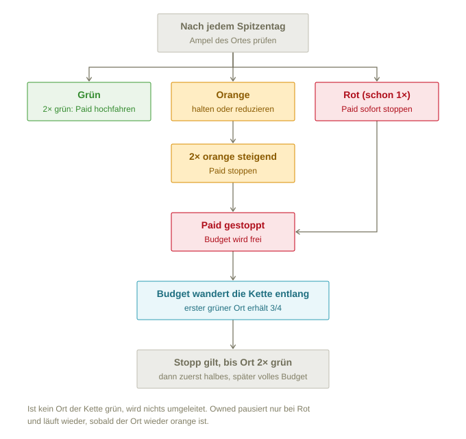

# Projekt Orange – Besucherlenkung Graubünden

Statische Webseite, die zeigt, wie ausgelastet Ausflugsziele an Spitzentagen sind, welche Kampagnen dafür laufen oder gestoppt wurden und wohin das Budget umgeleitet wird. Der Prototyp arbeitet mit erfundenen Beispieldaten für den Sommer 2026.

**Für alle, die verstehen wollen, wie es funktioniert:** [faq.html](faq.html) erklärt Dashboard, Regeln, Prognose und Betrieb in Fragen zum Aufklappen und ist im Dashboard oben rechts verlinkt. Diese README ist die technische Referenz.

## Inhalt

```
index.html            Seitenstruktur
faq.html              FAQ zum Aufklappen, verlinkt mit dem Dashboard
css/style.css         Gestaltung (hell und dunkel)
js/app.js             Logik: Daten laden, Ampel berechnen, Karte, Fieberkurve, Tabellen
js/lenkungsfluss.js   Substitutionsketten und Budgetfluss (aufklappbar)
data/orte.json        Attraktionen mit Kapazität, Schwellen, Substitut, Übernahme-Anteil
data/auslastung.json  Messwerte pro Attraktion und Spitzentag (inkl. Prognose)
data/kampagnen.json   Jede Statusänderung von Paid und Owned pro Attraktion (aus den Regeln erzeugt)
js/regeln.js          Steuerungsregeln als Programm (Prüfung, Simulation, Budget-Übersicht)
tools/kampagnen-erzeugen.js  Erzeugt kampagnen.json aus den Regeln (node)
data/kantonsumriss.json  Kantonsgrenze Graubünden (swisstopo swissBOUNDARIES3D, vereinfacht)
data/landesgrenze.json   Landesgrenze Schweiz im Kartenausschnitt (swisstopo, vereinfacht)
data/wetter.json      Wetter pro Attraktion und Spitzentag (inkl. Prognose)
docs/budgetregeln.svg Flussdiagramm: wann das Budget gestoppt und weitergegeben wird
```

Abhängigkeiten aus dem Netz: d3 7.9.0 (cdnjs) und die Schrift Fira Sans (Google Fonts). Beides kann für den Betrieb auch lokal abgelegt werden.

## Gestaltung

Nach dem Basis-Styleguide Online Medien graubünden (Oktober 2013): Farben granit, granat, sommergelb, wiesengrün und himmelblau als Variablen oben in `css/style.css`, Text in Arial, Titel in TheMix. Solange keine lizenzierte TheMix-Webfont eingebunden ist, springt Fira Sans ein; wird TheMix per `@font-face` eingebunden, greift sie automatisch. Der Dunkelmodus ist im Styleguide nicht definiert und aus den Granit-Tönen abgeleitet.

Nach Änderungen an CSS oder JS die Versionsnummer (`?v=15`, in `index.html` und `faq.html`) in `index.html` erhöhen, damit Browser nicht die alte Datei aus dem Cache nehmen.

## Lokal starten

Die Seite lädt ihre Daten per `fetch`, deshalb funktioniert sie nicht durch einen Doppelklick auf `index.html`. Im Ordner einen einfachen Webserver starten:

```
python3 -m http.server 8000
```

und `http://localhost:8000` öffnen. Auf jedem Webhosting (statisch genügt) läuft sie ohne weitere Konfiguration.

### Veröffentlichen mit GitHub Pages

Das Repository auf GitHub hochladen, dann unter *Settings → Pages* „Deploy from a branch“, Branch `main`, Ordner `/ (root)` wählen. Nach ein bis zwei Minuten ist die Seite unter `https://<konto>.github.io/<repository>/` erreichbar. Live: **https://projekt-orange.digital** (eigene Domain über die Datei `CNAME`, DNS bei Swizzonic: A-Einträge auf GitHub Pages, `www` als CNAME auf `sylagency.github.io`). Die Datei `.nojekyll` sorgt dafür, dass GitHub die Dateien unverändert ausliefert.

GitHub Pages ist öffentlich: Wer den Link kennt, sieht die Seite. `robots.txt` und `noindex` halten Suchmaschinen fern, ersetzen aber keinen Zugriffsschutz. Für echte Daten braucht es ein Hosting mit Login.

Der Zustand steht in der Adresse (`#datum=2026-08-09&thema=alle&ort=heidsee`), so lassen sich Ansichten als Link teilen.

## Datenmodell

Für den Echtbetrieb die URLs oben in `js/app.js` (`DATA`) auf die eigene Schnittstelle zeigen lassen. `landesgrenze.json` und `wetter.json` sind optional: fehlen sie, läuft das Dashboard ohne Landesgrenze bzw. ohne Wettersymbole. Solange diese das gleiche JSON-Format liefert, muss an der Seite nichts geändert werden.

### orte.json

| Feld | Bedeutung |
|---|---|
| `ort_id` | Eindeutige Kennung |
| `name`, `region`, `thema` | Anzeige und Themenfilter |
| `lat`, `lon` | Koordinaten (WGS84) |
| `messgroesse`, `datenquelle` | Was gemessen wird und woher |
| `kapazitaet` | Überprüfbare Kapazität (z. B. Anzahl Parkplätze, bewilligte Maximalbelegung) |
| `schwelle_orange`, `schwelle_rot` | Prozent der Kapazität |
| `substitut` | `ort_id` des nächsten Ortes in der Substitutionskette, leer am Ende der Kette. Die ganze Kette ergibt sich, indem man von Ort zu Ort weitergeht. |
| `uebernahme_pct` | Anteil eines gestoppten Budgets, den dieser Ort als Substitut erhält: 75 % Standard, 25–50 % für sehr kleine Orte. Zu Saisonbeginn festgelegt. Massgebend ist der Anteil des Ortes, der das Budget am Ende erhält; Orte, die nur weitergeben, kürzen nichts. Ausgangspunkt ist das zuletzt laufende Budget. |
| `paid_start_chf` | Eigenes Paid-Budget pro Woche zu Saisonbeginn, 0 wenn der Ort nur als Substitut Budget erhält. „Hochfahren“ führt nie über diesen Wert. |

### auslastung.json

Eine Zeile pro Attraktion und Spitzentag: `ort_id`, `datum` (JJJJ-MM-TT), `messwert`, `auslastung_pct` (0–100), `prognose` (true/false).

Nur Spitzentage gehören hinein (Wochenende oder Feiertag mit schönem Wetter). An gewöhnlichen Tagen sagt die Auslastung nichts über eine Überlastung aus.

### wetter.json

Eine Zeile pro Attraktion und Spitzentag: `ort_id`, `datum`, `wetter` (sonnig, wechselhaft, regnerisch), `tmax` (°C), `sonnenstunden`, `niederschlag_mm`, `prognose` (true/false). Im Echtbetrieb zusätzlich `abgerufen_am`. Angezeigt als Symbol unter dem Zeitregler und unter der Fieberkurve (Prognosen blasser) sowie in der Detailansicht mit einer Prognosetabelle der nächsten Spitzentage. Im Prototyp ist das Wetter passend zur Auslastung gewählt: bei Bergseen und Schluchten sind schwächere Tage wechselhaft, bei Thermen sind starke Tage verregnet (Feiertage 1. und 15. August sonnig).

### kampagnen.json

Eine Zeile pro Statusänderung: `kampagne_id`, `ort_id`, `ort`, `art` (Paid/Owned), `kanal`, `datum_ab`, `status` (aktiv, reduziert, gestoppt, pausiert), `budget_chf_woche`, `hinweis` (Grund), `budget_von` (`ort_id` der gestoppten Orte, deren Budget diese Kampagne übernimmt, mehrere mit Komma getrennt, sonst leer; wird der Empfänger selbst gestoppt, reicht er dieses Budget mit seinem eigenen weiter). Der aktuelle Stand einer Kampagne ist ihre letzte Zeile mit `datum_ab` bis zum gewählten Tag.

## Regeln

Die Ampel wird in `berechneAmpel()` berechnet: Auslastung unter der Orange-Schwelle ist grün, ab der Orange-Schwelle orange, ab der Rot-Schwelle rot.

Ziel ist orange: ausgelastet, aber nicht überlastet. Die Steuerung folgt dem Grundsatz „schnell bremsen, langsam Gas geben“:

| Lage an den letzten Spitzentagen | Paid | Owned |
|---|---|---|
| grün | halten | aktiv |
| 2× grün hintereinander | hochfahren, zurück aufs Saisonstart-Budget (nie darüber) | aktiv |
| orange | halten oder reduzieren | aktiv |
| 2× orange mit steigender Tendenz | stoppen | aktiv |
| 1× rot | stoppen | pausieren |
| nach rot wieder orange | gestoppt lassen | wieder aktiv |
| nach Stopp 2× grün | mit halbem Budget wieder aufnehmen | aktiv |
| danach grün | volles Budget zurück | aktiv |

Bei einem Stopp wandert das Budget die Substitutionskette entlang bis zum ersten Ort, der grün ist (er erhält seinen Übernahme-Anteil, standardmässig 75 %), notfalls bis zum letzten Ort der Kette. Orte dazwischen, die orange oder rot sind, geben einfach weiter. Ist kein Ort der Kette grün, wird nichts umgeleitet.



- **Wann:** Die Regeln werden nach jedem Spitzentag angewendet. 1× rot stoppt sofort, bei orange erst nach zwei Spitzentagen mit steigender Tendenz.
- **Wohin:** zum ersten grünen Ort der Kette. Wird ein Empfänger selbst gestoppt, gibt er sein eigenes und das übernommene Budget weiter.
- **Wie lange:** Die Umleitung gilt, solange Paid am Ausgangsort gestoppt ist. Wieder aufgenommen wird erst nach 2× grün hintereinander.
- **Rückgabe in zwei Stufen:** Nach 2× grün startet der Ausgangsort mit halbem Budget (Stufe „reduziert“), der Empfänger behält die Hälfte seines Übernahme-Betrags. Am nächsten grünen Spitzentag erhält der Ausgangsort das volle Budget zurück und der Empfänger fällt auf sein eigenes Budget zurück; ist der Tag orange, bleibt es beim halben Budget. Wird der Ausgangsort dazwischen rot, wird sofort wieder gestoppt.
- **Owned** pausiert nur bei rot und läuft wieder, sobald der Ort wieder orange ist (unter der Rot-Schwelle), auch wenn Paid noch gestoppt ist. So hängt jede Regel an einer Ampelfarbe, ohne eigenen Zwischenwert.

### Regeln als Programm: js/regeln.js

Alle Regeln dieses Abschnitts sind in `js/regeln.js` umgesetzt, die einzige Quelle der Wahrheit. Die Datei läuft im Browser und in Node:

- `Regeln.rechne(orte, ampel, dates)` wendet die Regeln Tag für Tag an und liefert die Kampagnenzeilen (Format wie `kampagnen.json`) sowie pro Tag den Zustand jedes Ortes und die Budgetstücke (wessen Budget bei wem liegt).
- `Regeln.pruefe(gespeichert, erwartet, dates)` vergleicht gespeicherte Entscheide mit den Regeln.
- Das Dashboard prüft beim Laden alle gespeicherten Entscheide bis zum Stand (Hinweis unter „Steuerungsverlauf“), simuliert die Prognosetage (Kennzeichnung „Simulation“) und berechnet daraus die Budget-Übersicht und den Lenkungsfluss.
- `node tools/kampagnen-erzeugen.js` erzeugt die Beispieldaten in `kampagnen.json` aus den Regeln. Im Echtbetrieb läuft derselbe Code nach jedem Spitzentag auf dem Server und schreibt die Entscheide, idealerweise direkt mit Anbindung an die Werbekonten.

Für Empfänger gelten dieselben Regeln wie für alle Orte (orange halbiert ihr Paid). Übernommenes Budget bleibt beim Empfänger, bis dieser selbst gestoppt wird.

### Graue Orte (keine gültigen Daten)

Grau heisst: kein gültiger Messwert, weil Daten fehlen oder der Wert unplausibel ist (null an einem Spitzentag, über der Kapazität). Regeln:

- **Letzten Entscheid halten:** Paid und Owned bleiben, wie sie sind. Gestoppt bleibt gestoppt, hochgefahren wird nicht.
- **Grau unterbricht die Zählung:** „2× grün hintereinander“ und „2× orange steigend“ beginnen nach einem grauen Tag von vorn.
- **Kein Budget an graue Orte:** Als Substitut wird ein grauer Ort nie wie grün behandelt und gibt an den nächsten Ort der Kette weiter (im Dashboard umgesetzt: „ohne Daten, gibt weiter“).
- **Ab 2× grau hintereinander:** Alarm an die Destination und an Graubünden Ferien, mit Grund („keine Daten“ oder „unplausibel: …“). Die Werbung wird nicht automatisch gestoppt.

Im Dashboard erscheint ein grauer Ort mit grauem Punkt bzw. Farbbalken, „keine Daten“ bzw. „—“ statt einer Zahl, und in der Fieberkurve fehlt der Tag. Die Beispieldaten enthalten keinen grauen Tag. Für den Echtbetrieb liefert die Schnittstelle für einen grauen Tag am besten eine Zeile mit `auslastung_pct: null` und einem Feld `grund`; das Dashboard muss dafür so erweitert werden, dass es den Grund im Tooltip zeigt.

## Prognose im Echtbetrieb

Im Prototyp sind die Prognosen (`prognose: true` in `auslastung.json` und `wetter.json`) erfundene Werte. Für den Echtbetrieb braucht es einen Prognose-Dienst auf dem Server.

**Was:** Auslastung in % pro Ort für die kommenden Spitzentage, etwa 10 Tage voraus. Die Wetterprognose entscheidet zuerst, ob ein Tag überhaupt ein Spitzentag ist.

**Eingangsdaten:**

- gemessene Auslastung der vergangenen Spitzentage pro Ort
- Wetterprognose pro Ort: Sonnenstunden, Höchsttemperatur, Niederschlag
- Kalender: Schulferien CH/DE/NL/BE, Feiertage, Brückentage
- Trend der letzten 2–3 Spitzentage
- Kampagnenstand (Paid aktiv, reduziert oder gestoppt)
- optional Events, Logiernächte, Verkehrsdaten

**Methode in zwei Stufen:**

1. Ab Start: Durchschnitt vergleichbarer früherer Spitzentage desselben Ortes mit ähnlichem Wetter, plus Zuschläge für Ferien/Feiertag und Trend. Funktioniert ab einer Saison Daten und ist vollständig nachvollziehbar.
2. Ab etwa zwei Saisons: statistisches Modell (z. B. Regression auf alle Eingangsdaten), das eine Bandbreite liefert, etwa „68–82 %, Wahrscheinlichkeit rot 30 %“.

**Ablauf:** Ein Server-Job läuft jeden Morgen und schreibt die Prognosen im Format von `auslastung.json` mit `prognose: true`, ergänzt um `erstellt_am` und ab Stufe 2 `pct_min`/`pct_max` (Bandbreite, dafür das Dashboard leicht erweitern). Nach dem Tag ersetzt der Messwert die Prognose. Die Prognosegüte (durchschnittliche Abweichung) wird pro Ort laufend gemessen.

**Rolle in der Steuerung:** Die Regeln steuern heute nur nach gemessenen Werten. Empfehlung: Prognose zuerst nur anzeigen und erst nach einer Saison mit guter Prognosegüte als Frühwarnung einsetzen (z. B. „Prognose rot → Paid vorsorglich reduzieren“, weil Werbung mit Verzögerung wirkt).

## Wetterprognose im Echtbetrieb

**Quelle:** MeteoSchweiz (Open Government Data: lokale Prognosen und Stationsmesswerte) als amtliche Quelle. Alternativen: meteoblue (kostenpflichtige API) oder Open-Meteo. Genaue Schnittstellen bei der Umsetzung prüfen.

**Anbindung:** Nicht direkt aus dem Browser, sondern über den Server-Job: einmal pro Tag abholen, zwischenspeichern, als `data/wetter.json` bereitstellen. Pro Ort zählen Koordinaten und Höhe. Für das Training der Prognose braucht es auch vergangenes Wetter; dafür erhält jeder Ort in `orte.json` ein Feld `wetter_station` (nächste MeteoSchweiz-Messstation).

**Wetter wirkt je nach Thema gegensätzlich:** Sonne füllt Bergseen und Schluchten, Regen füllt Thermen. Die Wetterklasse wird deshalb pro Thema gedeutet. Möglich wäre später eine themenübergreifende Umleitung (an Regentagen Bergsee-Budget zu Wellness).

## Anforderungen an echte Daten

- Messwerte kommen automatisch aus dem Quellsystem (Parkleitsystem, Kasse, Drehkreuz, Zähler), nie aus manueller Eingabe. Rohdaten unverändert speichern.
- Destinationen setzen Kapazität, Schwellen und Übernahme-Anteil selbst, aber innerhalb fester Bandbreiten (z. B. orange 50–70 %, rot 80–95 %). Änderungen nur vor Saisonbeginn, protokolliert und von Graubünden Ferien freigegeben.
- Unplausible Werte (null an einem Spitzentag, über der Kapazität) werden markiert statt verwendet. Fehlende Daten ergeben grau, nie grün.
- Kantons- und Landesgrenze stammen bereits von swisstopo (frei nutzbar, Quellenangabe „swisstopo“ steht in der Kartenlegende).
